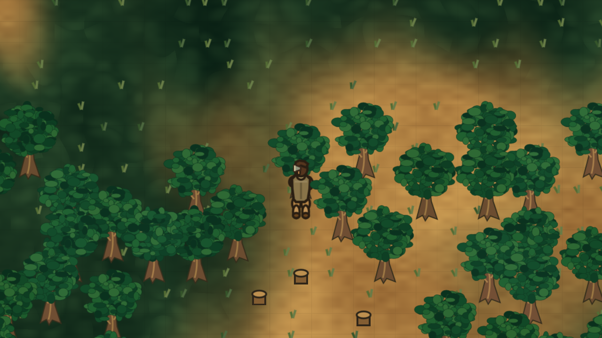
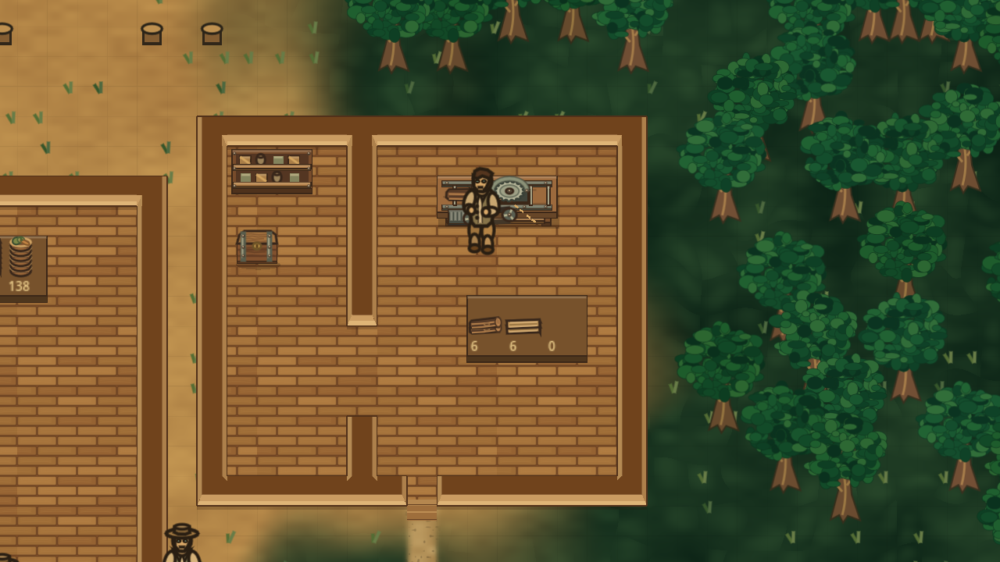

# Project Living World

A single-player frontier sandbox. Start in Alder Hollow with five residents, follow
goods from the forest to the sawmill and market, and watch villagers build homes
as the settlement grows. Reedbank is a separate settlement on the same map.


| Forest harvesting | Sawmill production |
|---|---|
| [](docs/screenshots/forest-harvest.png) | [](docs/screenshots/workshop-production.png) |

[View the full screenshot gallery](docs/SCREENSHOTS.md) · [Watch the character animations](docs/screenshots/character-motion.gif)

## Start the game

Clone or download this repository, then open [project.godot](project.godot)
in **Godot 4.6 stable**, standard edition, and press **F5** in the editor. The
pinned build is `4.6.stable.official.89cea1439`. If you have already exported the
Mac app locally, open `builds/macos/LivingWorld-release.app`. See the export
instructions below to build it from a fresh checkout.

If the portable engine is present on this Mac, run from the project folder:

```sh
GODOT_BIN=/private/tmp/living-world-engine/Godot.app/Contents/MacOS/Godot
"$GODOT_BIN" --path .
```

| Control | Action |
|---|---|
| **WASD**, **Shift** | Walk (including diagonals with two keys) or sprint. Sprint drains stamina. |
| **Wheel** or **pinch**, **Tab** | Zoom. Tab toggles camera follow so you can pan around the region. |
| **I**, **F**, **H** | Open inventory, interact, or inspect body health. Right-click a body part for treatment. |
| **Right mouse**, **Left mouse**, **Space** | Face the cursor, hold left mouse to ready, right mouse plus left click to punch, or Space to shove. |
| **1 / 2 / 3 / 4** | Use hotbar slot 1-4 (assign items in the inventory, **I**). Use it again to put the item away. |
| **P**, **,** / **.** | Pause, slower or faster time; the bottom-right clock has the same controls. |
| **E**, **Q** | Eat food from your inventory, or drink at a well barrel. |
| **F4** | Performance tab (top right): fps, frame-time percentiles and graph, render counters, simulation and world figures; Record writes `perf_log.csv` to the save folder. |
| **Right-click twice** | Walk to that square. **Left-click** a person or object for an action menu; **C** opens your clothing. |
| **M** | Map view: frame every town, pan with WASD, zoom with the wheel, M again to return. |
| **X**, **R** | Ready or stow the shotgun; reload it. Aim with right mouse and click to fire. Take one from the sheriff's office rack with **F**. |
| **T**, **G** | Rotate the nearest furniture item, or move it to its best spot against a wall (inside a building). |
| **F5 / F9**, **Esc** | Save or load in the running game, or close the open panel. |
| **F3 / F8** | Open observer tools or toggle the extra HUD details. |

To trade, walk to the front of a **Timber** or **Provisions** stall near the
village square and press **F**. Start there to see actual stall stock and prices.

## Documentation

| File | Use it for |
|---|---|
| [Current game guide](docs/CURRENT_GAME.md) | Current controls, village workflows, where files live, and how to back up a save |
| [Implementation status](docs/IMPLEMENTATION_STATUS.md) | Shipped blueprint milestones and scope limits |
| [Contributing](CONTRIBUTING.md) | Project setup, test expectations, and where to report a problem |
| [Decisions](docs/DECISIONS.md) | Technical and design decisions, including later changes that supersede earlier ones |
| [Changelog](docs/CHANGELOG.md) | What changed and when |
| [Validation](docs/VALIDATION.md) | Checks, screenshots, benchmarks and their dates |
| [Blueprint](docs/01_GAME_FOUNDATION.md) · [Technical layers](docs/02_TECHNICAL_LAYERS.md) · [Roadmap](docs/03_BUILD_ROADMAP.md) · [Contributor brief](docs/04_CODEX_START_HERE.md) | Original project intent and implementation plan |

## Save and back up

On this Mac, Godot saves to
`~/Library/Application Support/Godot/app_userdata/Project Living World/`.
Copy `living_world.save`, `living_world.save.bak`, and `controls.cfg` if present.
Source, documentation, and saved games are separate. See the
[backup instructions](docs/CURRENT_GAME.md#what-is-stored-and-where).

## Test and export

```sh
GODOT_BIN=/path/to/Godot scripts/test.sh
"$GODOT_BIN" --headless --path . --script res://tests/production_test.gd
"$GODOT_BIN" --path . --script res://tests/market_capture.gd
```

Install the Godot **4.6 stable** export templates to export desktop builds. The
scripts write local artifacts to the ignored `builds/` folder.

```sh
scripts/prepare_exports.sh /path/to/Godot_v4.6-stable_export_templates.tpz
GODOT_BIN=/path/to/Godot scripts/export.sh
```

For only the Mac release, run:

```sh
"$GODOT_BIN" --headless --path . --export-release macOS builds/macos/LivingWorld-release.app
```
