# Project Solo

> **To play on a Mac: open `Project Solo.app`, the first item in this folder.** It needs the free
> Godot 4.6 engine and tells you if it is missing. On Windows, or for a standalone app, see
> [Download and play](#download-and-play). Everything the game is made of is in the [`source`](source) folder.

A single-player frontier life sandbox built in Godot 4.6. Three towns (Alder
Hollow, Reedbank and dusty Dustvale) live far apart on one large, forested map: villagers farm rye, fell
trees, saw planks, bake, mine iron, trade at the market, keep households, sleep
in their beds at night, and remember who wronged them. You arrive with a
backpack and nothing else.

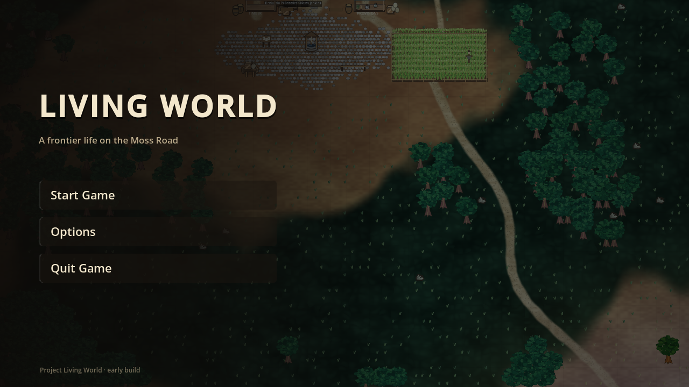

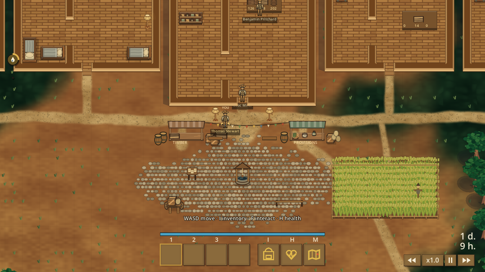

## What's in the game

| | |
|---|---|
| [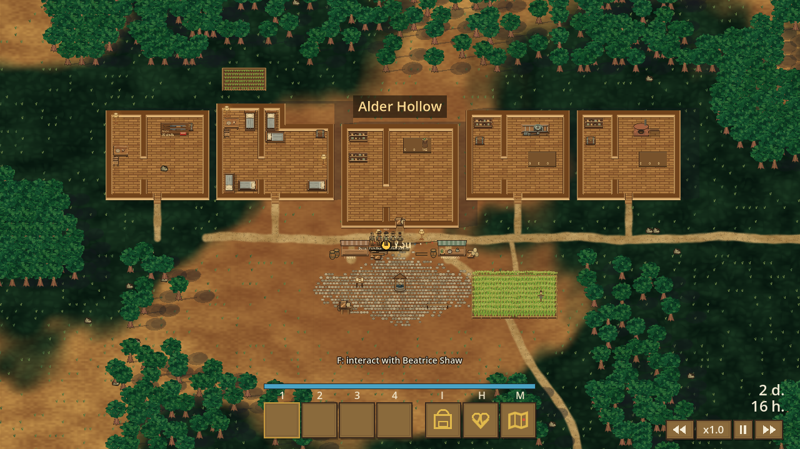](source/docs/screenshots/forest-overview.png) **Woods and towns.** About 1,070 trees form real forests around the towns, with clearings around every house, door, workshop, field and road. | [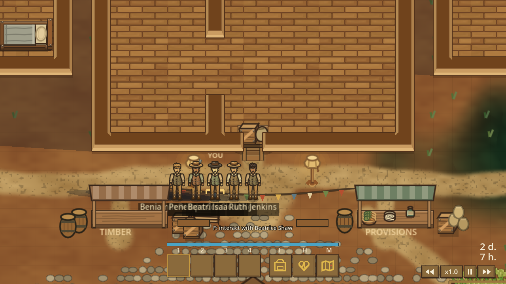](source/docs/screenshots/shadows-07h00.png) **The sun moves.** Shadows stretch left in the morning, shrink at noon, lengthen to the right in the evening and fade at night. |
| [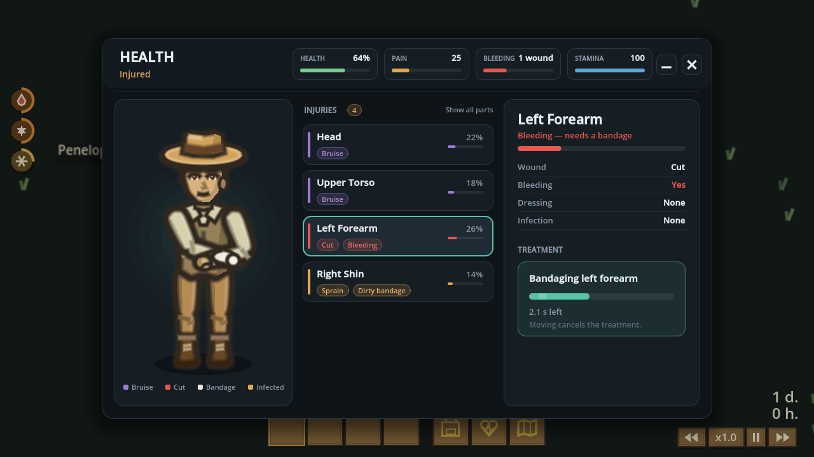](source/docs/screenshots/health-window-bandaging.png) **Health.** Bruises, cuts, bleeding and infection per body part; treat them from a modern health window while your character bandages themselves. | [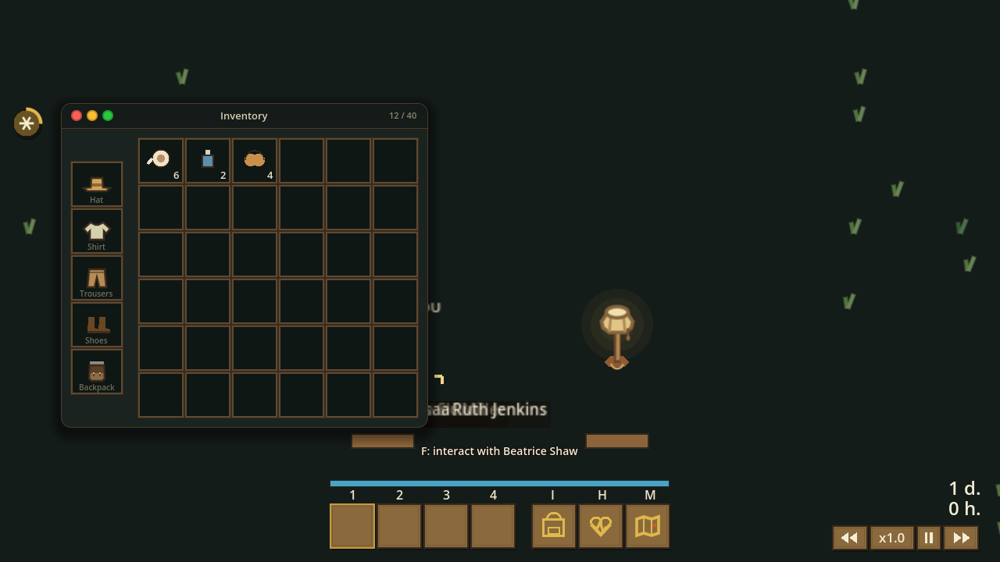](source/docs/screenshots/inventory-grid.png) **Inventory.** A 6×6 grid with hat, shirt, trousers and shoes squares. Opening it, you kneel and go through your backpack. |
| [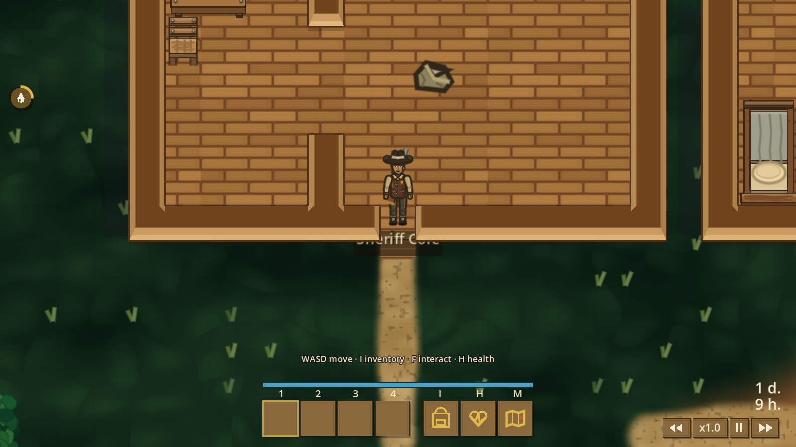](source/docs/screenshots/sheriff-in-town.png) **The law.** Every town has a Sheriff in a dark cattleman hat and a star on his vest, a shotgun on his back, and a weapon rack at the office. | [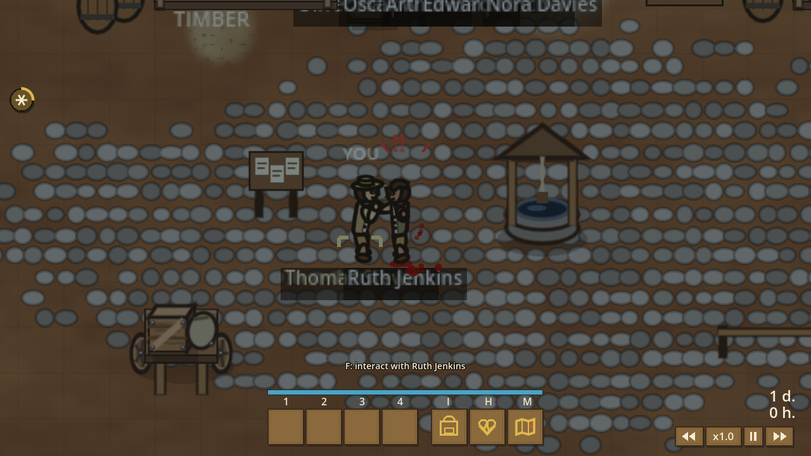](source/docs/screenshots/fight-punch.png) **Fights.** Punch or shove someone and they come after you; do it twice and they'll beat you unconscious. Blunt hits bruise where they land. |
| [](source/docs/screenshots/animation-crouch.png) **Sneak.** Crouch with X to move quietly; rob a sleeper without waking them. | [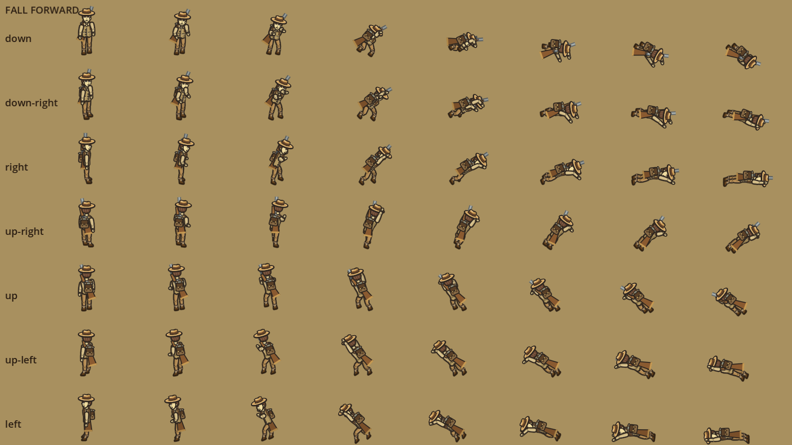](source/docs/screenshots/animation-falls.png) **Falls.** A full forward fall and a staged get-up (push-up, hands and knees, kneel, stand) in all eight directions. |
| [](source/docs/screenshots/house-types.png) **Houses for households.** 13 house types with 1-3 beds; families build bigger, people living alone take a cabin or shack. Towns grow irregularly, never across the roads. | [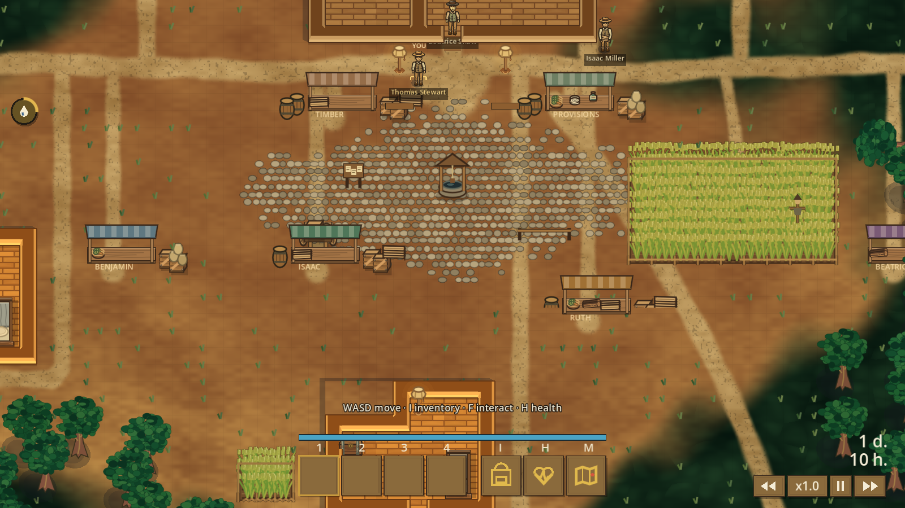](source/docs/screenshots/market-tents.png) **Market tents and traders.** Every seller keeps their own tent; a trader walks between the towns buying cheap and selling dear, only while prices make it pay. |
| [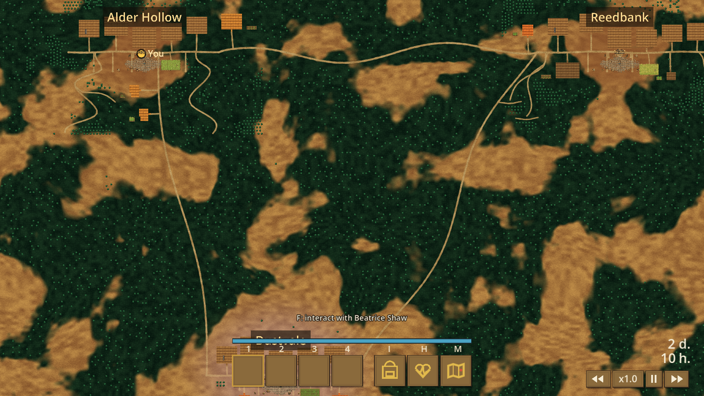](source/docs/screenshots/world-big-map.png) **A bigger land.** The towns are a real journey apart, with wild forests filling the green ground between them. | [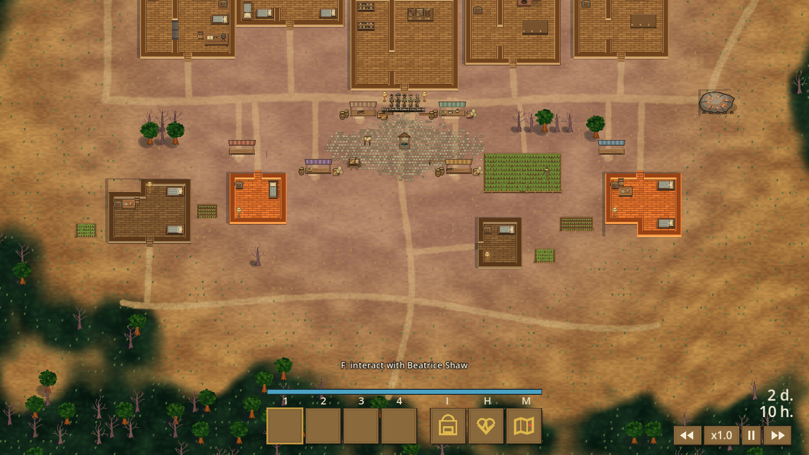](source/docs/screenshots/town-dustvale.png) **Dustvale.** A dry-country town far to the south, built in adobe and stone, with a great iron rock to mine. | [](source/docs/screenshots/rye-growth.png) **Farming.** Rye grows through six stages; households keep gardens and pantries. |

**Also:** a click menu for every person and object (Kenshi-style) with walk-to-and-act,
loot chests and people (including their clothes), 4-slot hotbar, needs
indicators, stamina with fatigue and collapse, a map view, a performance tab,
furniture you can rotate and rearrange, and a title screen that flies down to
your character when you start.

[Full screenshot gallery](source/docs/SCREENSHOTS.md) · [Changelog](source/docs/status/CHANGELOG.md) · [Character animations (GIF)](source/docs/screenshots/character-motion.gif)

## Download and play

Pick the way that suits you. Windows and Mac players can get a ready-to-run build; everyone can run
the game from the source with the free engine, **Godot 4.6**.

### macOS: double-click `Project Solo.app`

1. Get the game: `git clone https://github.com/eelundin3-sketch/project-solo.git`, or **Code → Download ZIP** on GitHub, then unzip.
2. Install **Godot 4.6 stable** (standard edition, not ".NET") from the
   [Godot 4.6 archive](https://godotengine.org/download/archive/4.6-stable/), and put `Godot.app` in your Applications folder.
   Newer versions (4.7 and later) can upgrade the project files, so use 4.6.
3. Open **`Project Solo.app`**, which is the first item in the downloaded folder. It finds Godot 4.6 and starts the game from this
   folder, so it is always the current version. If Godot is missing it tells you where to get it.
4. **First launch from a ZIP download:** macOS blocks apps it cannot check. Either run
   `xattr -cr "Project Solo.app"` once in Terminal (in this folder), or try to open it, then go to
   **System Settings → Privacy & Security → Open Anyway**. (A plain `git clone` has no such prompt. On macOS 15 and later,
   right-click → Open no longer gets past it.) The same applies to Godot itself the first time you open it.

Prefer a standalone app that needs no Godot? Download **`Project-Solo-macOS.zip`** from the repository's **Releases** page
(or from **Actions → Build → the latest run → Artifacts**), unzip it and open `Project Solo.app` inside it, with the same first-launch step as above.

### Windows 11: no Godot needed

1. Download **`Project-Solo-Windows.zip`** from the repository's **Releases** page (or **Actions → Build → the latest run → Artifacts**).
2. **Unzip** it anywhere (don't run it from inside the zip) and double-click **`ProjectSolo.exe`**.
3. The game is not code-signed, so Windows shows *"Windows protected your PC"*: click **More info**, then **Run anyway**.
4. Saves go to `%APPDATA%\Godot\app_userdata\Project Solo\`.

### From source (any platform)

1. Get the repository (clone or ZIP) and **Godot 4.6** as above (on Windows and Linux the download is a single program, no installer).
2. **From the editor:** start Godot, choose **Import**, pick `source/project.godot`, open it and press **F5**.
3. **From a terminal**, inside the `source` folder:
   ```sh
   scripts/play.sh                               # finds Godot 4.6 for you (macOS and Linux)
   GODOT_BIN=/path/to/Godot scripts/play.sh      # or say where it is
   /path/to/Godot --path .                       # any platform, without the script
   ```

Then **start a new game** from the title screen. You arrive in Alder Hollow with a backpack, a shotgun (lowered) and not much else.
The controls are below.

| Control | Action |
|---|---|
| **WASD**, **Shift**, **X** | Walk (two keys for diagonals), sprint (drains stamina; run it dry and you collapse), or crouch to sneak. |
| **Left-click** | Open the action menu on a person or object (punch, shove, talk, loot, chop, mine, bandage…). Double-click open ground to walk there. |
| **Right-click twice** | Walk to that square. Hold **Shift** while walking a route or to a target to run. |
| **Wheel** or **pinch**, **Tab**, **M** | Zoom, toggle camera follow, or open the map view. |
| **I**, **H**, **C** | Inventory (6×6 grid, clothing squares), health window, or your clothes. |
| **F**, **E**, **Q** | Interact, eat, or drink at a well. |
| **Right mouse** + **Left mouse**, **Space** | Ready your fists and punch, or shove. |
| **1 / 2 / 3 / 4** | Hotbar slots; weapons you pick up go there automatically. With the shotgun ready, hold right mouse to aim and left mouse to fire; **R** reloads. |
| **P**, **,** / **.** | Pause, slower or faster time (also the bottom-right clock). |
| **T**, **G** | Rotate the nearest furniture item, or move it to its best spot against a wall. |
| **F4**, **F5 / F9**, **Esc** | Performance tab, save / load, close the open window. |

To trade, walk to the front of a **Timber** or **Provisions** stall near the
village square and press **F**. Start there to see actual stall stock and prices.

## Project layout

The top of the folder holds only what a player needs: **`Project Solo.app`**, this README and the `source` folder.
Inside `source/`:

| Folder | What is in it |
|---|---|
| `sim/` | The simulation (authoritative, headless): world, residents, law, combat, economy |
| `view/`, `app/` | Everything drawn, heard and clicked, and the controller that wires it to the simulation |
| `content/` | Art, audio and data definitions |
| `tests/` | `sim/` and `view/` tests, `captures/` screenshot scripts, `soak/`, `benchmark/` |
| `tools/`, `scripts/` | Asset generators and the layout checker; the test runner, exports and play script |
| `docs/` | `design/` (the blueprint), `status/` (changelog, current game), `validation/`, `screenshots/` |

## Documentation

| File | Use it for |
|---|---|
| [Current game guide](source/docs/status/CURRENT_GAME.md) | Current controls, village workflows, where files live, and how to back up a save |
| [Implementation status](source/docs/status/IMPLEMENTATION_STATUS.md) | Shipped blueprint milestones and scope limits |
| [Contributing](.github/CONTRIBUTING.md) | Project setup, test expectations, and where to report a problem |
| [Decisions](source/docs/design/DECISIONS.md) | Technical and design decisions, including later changes that supersede earlier ones |
| [Changelog](source/docs/status/CHANGELOG.md) | What changed and when |
| [Validation](source/docs/validation/VALIDATION.md) | Checks, screenshots, benchmarks and their dates |
| [Blueprint](source/docs/design/01_GAME_FOUNDATION.md) · [Technical layers](source/docs/design/02_TECHNICAL_LAYERS.md) · [Roadmap](source/docs/design/03_BUILD_ROADMAP.md) · [Contributor brief](source/docs/design/04_CODEX_START_HERE.md) | Original project intent and implementation plan |

## Save and back up

On this Mac, Godot saves to
`~/Library/Application Support/Godot/app_userdata/Project Solo/`.
Copy `project_solo.save`, `project_solo.save.bak`, and `controls.cfg` if present.
Source, documentation, and saved games are separate. See the
[backup instructions](source/docs/status/CURRENT_GAME.md#what-is-stored-and-where).

## Test and export

```sh
cd source
GODOT_BIN=/path/to/Godot scripts/test.sh
"$GODOT_BIN" --headless --path . --script res://tests/sim/production_test.gd
"$GODOT_BIN" --path . --script res://tests/captures/market_capture.gd
```

Install the Godot **4.6 stable** export templates to export desktop builds. The
scripts write local artifacts to the ignored `builds/` folder.

```sh
tools/prepare_exports.sh /path/to/Godot_v4.6-stable_export_templates.tpz
GODOT_BIN=/path/to/Godot scripts/export.sh
```

A Mac build is only a snapshot. If you export one, rebuild it after every change, and do not
use it to judge the current game; run from the project instead (see above).

```sh
"$GODOT_BIN" --headless --path . --export-release macOS builds/macos/ProjectSolo-release.app
```
