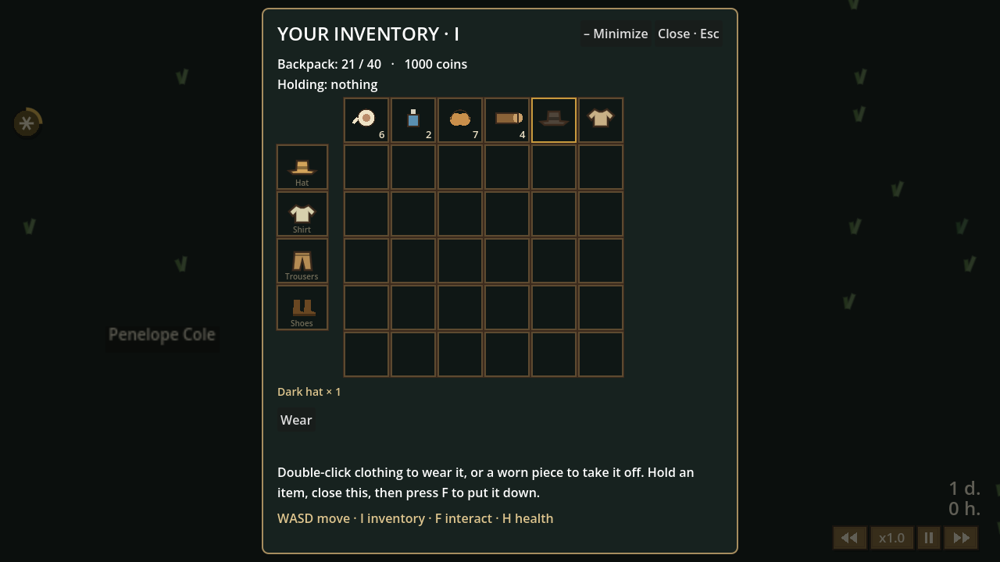
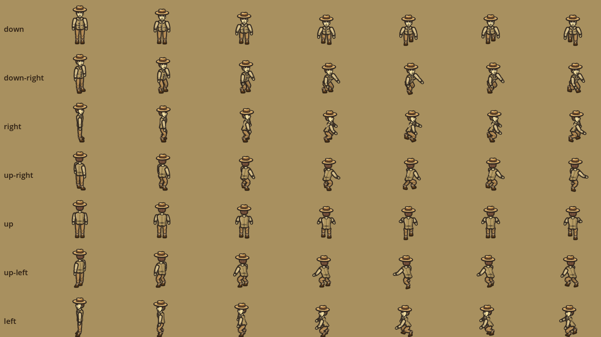
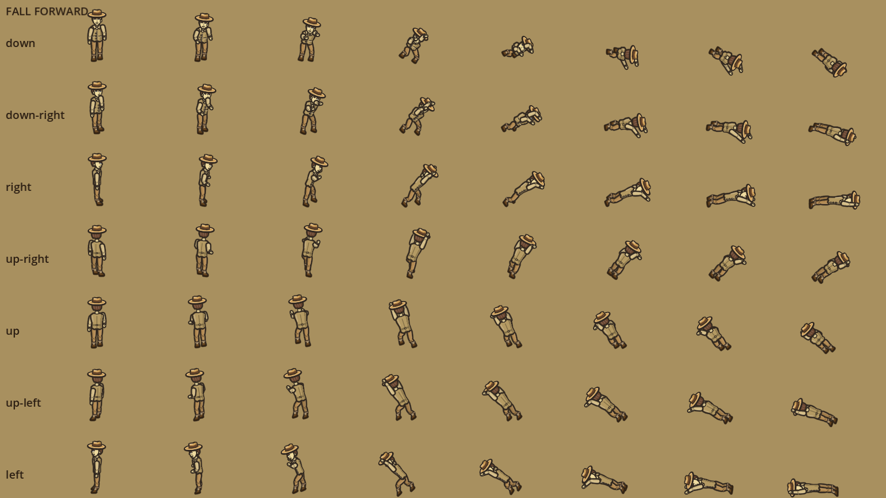
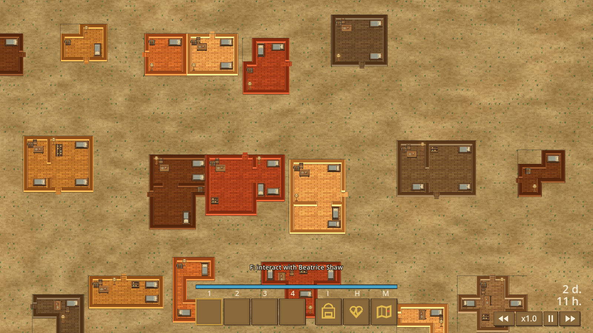
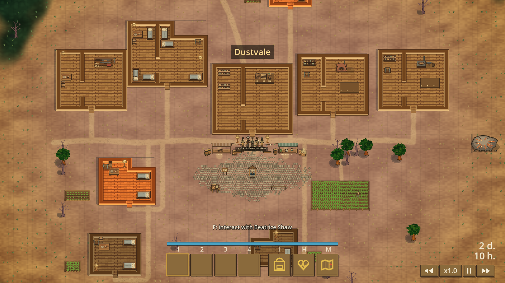
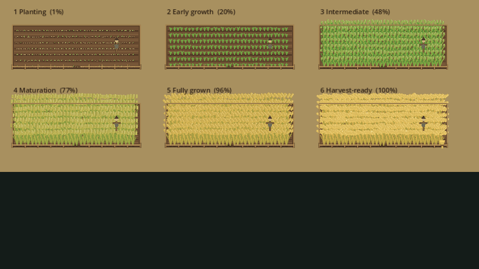

# Project Living World

A single-player frontier life sandbox built in Godot 4.6. Three towns (Alder
Hollow, Reedbank and dusty Dustvale) live far apart on one large, forested map: villagers farm rye, fell
trees, saw planks, bake, mine iron, trade at the market, keep households, sleep
in their beds at night, and remember who wronged them. You arrive with a
backpack and nothing else.


## What's in the game

| | |
|---|---|
| [](docs/screenshots/forest-overview.png) **Woods and towns.** About 1,070 trees form real forests around the towns, with clearings around every house, door, workshop, field and road. | [](docs/screenshots/shadows-07h00.png) **The sun moves.** Shadows stretch left in the morning, shrink at noon, lengthen to the right in the evening and fade at night. |
| [](docs/screenshots/health-window-bandaging.png) **Health.** Bruises, cuts, bleeding and infection per body part; treat them from a modern health window while your character bandages themselves. | [](docs/screenshots/inventory-grid.png) **Inventory.** A 6×6 grid with hat, shirt, trousers and shoes squares. Opening it, you kneel and go through your backpack. |
| [](docs/screenshots/sheriff-in-town.png) **The law.** Every town has a Sheriff in a dark cattleman hat and a star on his vest, a shotgun on his back, and a weapon rack at the office. | [](docs/screenshots/fight-punch.png) **Fights.** Punch or shove someone and they come after you; do it twice and they'll beat you unconscious. Blunt hits bruise where they land. |
| [](docs/screenshots/animation-crouch.png) **Sneak.** Crouch with X to move quietly; rob a sleeper without waking them. | [](docs/screenshots/animation-falls.png) **Falls.** A full forward fall and a staged get-up (push-up, hands and knees, kneel, stand) in all eight directions. |
| [](docs/screenshots/house-types.png) **Houses for households.** 13 house types with 1-3 beds; families build bigger, people living alone take a cabin or shack. Towns grow irregularly, never across the roads. | [](docs/screenshots/market-tents.png) **Market tents and traders.** Every seller keeps their own tent; a trader walks between the towns buying cheap and selling dear, only while prices make it pay. |
| [](docs/screenshots/world-big-map.png) **A bigger land.** The towns are a real journey apart, with wild forests filling the green ground between them. | [](docs/screenshots/town-dustvale.png) **Dustvale.** A dry-country town far to the south, built in adobe and stone, with a great iron rock to mine. | [](docs/screenshots/rye-growth.png) **Farming.** Rye grows through six stages; households keep gardens and pantries. |

**Also:** a click menu for every person and object (Kenshi-style) with walk-to-and-act,
loot chests and people (including their clothes), 4-slot hotbar, needs
indicators, stamina with fatigue and collapse, a map view, a performance tab,
furniture you can rotate and rearrange, and a title screen that flies down to
your character when you start.

[Full screenshot gallery](docs/SCREENSHOTS.md) · [Changelog](docs/CHANGELOG.md) · [Character animations (GIF)](docs/screenshots/character-motion.gif)

## Download and play

You need two things: this repository and **Godot 4.6 stable** (the free game engine the project runs on).
No installer or build step is needed.

1. **Get the game.** Clone the repository, or use **Code → Download ZIP** on GitHub and unzip it.
   The repository is private, so you need to be added as a collaborator first.
   ```sh
   git clone https://github.com/eelundin3-sketch/project-living-world.git
   cd project-living-world
   ```
2. **Get Godot 4.6.** Download the standard edition (not ".NET") of **4.6 stable** from the
   [Godot 4.6 archive](https://godotengine.org/download/archive/4.6-stable/) for macOS, Windows or Linux.
   The pinned build is `4.6.stable.official.89cea1439`. Newer versions (4.7 and later) may upgrade the
   project files, so use 4.6.
   - **macOS:** unzip and drag `Godot.app` to Applications. Godot is unsigned, so the first time,
     right-click it and choose **Open**.
   - **Windows / Linux:** unzip; the download is a single program, with no installer.
3. **Play.** Either:
   - **From the editor:** start Godot, choose **Import**, pick this folder's `project.godot`, open it and
     press **F5** (or the ▶ button).
   - **From a terminal**, in the project folder:
     ```sh
     scripts/play.sh                       # finds Godot 4.6 for you (macOS and Linux)
     GODOT_BIN=/path/to/Godot scripts/play.sh   # or tell it where Godot is
     /path/to/Godot --path .               # any platform, without the script
     ```
4. **Start a new game** from the title screen. You arrive in Alder Hollow with a backpack and nothing else.
   The controls are listed below.

> Always run the game this way, from the project folder. Exported `.app`, `.exe` or Linux builds are
> snapshots of the day they were exported and do not update when the source does, so there are none
> in the repository.

### Play on Windows 11 (no Godot needed)

A ready-to-run Windows build is a single `LivingWorld.exe` (64-bit).

1. Download **`LivingWorld-Windows.zip`**:
   - from the repository's **Releases** page, when a release has been published; or
   - from **Actions → Windows build → the latest run → Artifacts** (you must be signed in to GitHub); or
   - build it yourself (below).
2. **Unzip** it anywhere. Do not run it from inside the zip.
3. Double-click **`LivingWorld.exe`**. The game is not code-signed, so Windows shows
   "Windows protected your PC": click **More info**, then **Run anyway**.
4. Click **Start Game**. Saves go to `%APPDATA%\Godot\app_userdata\Project Living World\`.

To build the zip yourself on macOS or Linux, with Godot 4.6 and its export templates installed
(`scripts/prepare_exports.sh`): `GODOT_BIN=/path/to/Godot scripts/package_windows.sh`
writes `dist/LivingWorld-Windows.zip`. To run from source on Windows instead, follow the steps
above with the Windows build of Godot 4.6 and press **F5**.

| Control | Action |
|---|---|
| **WASD**, **Shift**, **X** | Walk (two keys for diagonals), sprint (drains stamina; run it dry and you collapse), or crouch to sneak. |
| **Left-click** | Open the action menu on a person or object (punch, shove, talk, loot, chop, mine, bandage…). Double-click open ground to walk there. |
| **Right-click twice** | Walk to that square. Hold **Shift** while walking a route or to a target to run. |
| **Wheel** or **pinch**, **Tab**, **M** | Zoom, toggle camera follow, or open the map view. |
| **I**, **H**, **C** | Inventory (6×6 grid, clothing squares), health window, or your clothes. |
| **F**, **E**, **Q** | Interact, eat, or drink at a well. |
| **Right mouse** + **Left mouse**, **Space** | Ready your fists and punch, or shove. |
| **1 / 2 / 3 / 4** | Hotbar slots; weapons you pick up go there automatically. With the shotgun ready, hold right mouse to aim and left mouse to fire; **R** reloads. |
| **P**, **,** / **.** | Pause, slower or faster time (also the bottom-right clock). |
| **T**, **G** | Rotate the nearest furniture item, or move it to its best spot against a wall. |
| **F4**, **F5 / F9**, **Esc** | Performance tab, save / load, close the open window. |

To trade, walk to the front of a **Timber** or **Provisions** stall near the
village square and press **F**. Start there to see actual stall stock and prices.

## Documentation

| File | Use it for |
|---|---|
| [Current game guide](docs/CURRENT_GAME.md) | Current controls, village workflows, where files live, and how to back up a save |
| [Implementation status](docs/IMPLEMENTATION_STATUS.md) | Shipped blueprint milestones and scope limits |
| [Contributing](CONTRIBUTING.md) | Project setup, test expectations, and where to report a problem |
| [Decisions](docs/DECISIONS.md) | Technical and design decisions, including later changes that supersede earlier ones |
| [Changelog](docs/CHANGELOG.md) | What changed and when |
| [Validation](docs/VALIDATION.md) | Checks, screenshots, benchmarks and their dates |
| [Blueprint](docs/01_GAME_FOUNDATION.md) · [Technical layers](docs/02_TECHNICAL_LAYERS.md) · [Roadmap](docs/03_BUILD_ROADMAP.md) · [Contributor brief](docs/04_CODEX_START_HERE.md) | Original project intent and implementation plan |

## Save and back up

On this Mac, Godot saves to
`~/Library/Application Support/Godot/app_userdata/Project Living World/`.
Copy `living_world.save`, `living_world.save.bak`, and `controls.cfg` if present.
Source, documentation, and saved games are separate. See the
[backup instructions](docs/CURRENT_GAME.md#what-is-stored-and-where).

## Test and export

```sh
GODOT_BIN=/path/to/Godot scripts/test.sh
"$GODOT_BIN" --headless --path . --script res://tests/production_test.gd
"$GODOT_BIN" --path . --script res://tests/market_capture.gd
```

Install the Godot **4.6 stable** export templates to export desktop builds. The
scripts write local artifacts to the ignored `builds/` folder.

```sh
scripts/prepare_exports.sh /path/to/Godot_v4.6-stable_export_templates.tpz
GODOT_BIN=/path/to/Godot scripts/export.sh
```

A Mac build is only a snapshot. If you export one, rebuild it after every change, and do not
use it to judge the current game; run from the project instead (see above).

```sh
"$GODOT_BIN" --headless --path . --export-release macOS builds/macos/LivingWorld-release.app
```
