# Gameplay screenshots

These captures come from the game running in Godot. Click an image for the
full-size version.

| Village life | Making and trading |
|---|---|
| [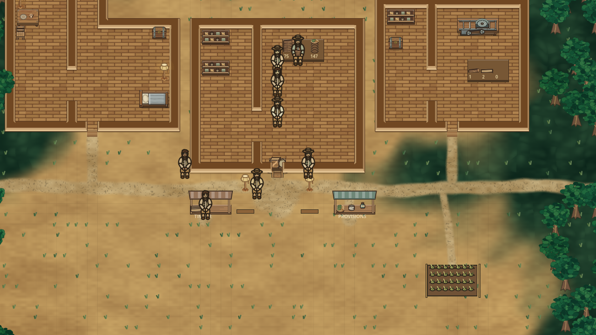](screenshots/market-stalls.png) **Alder Hollow and its market square** | [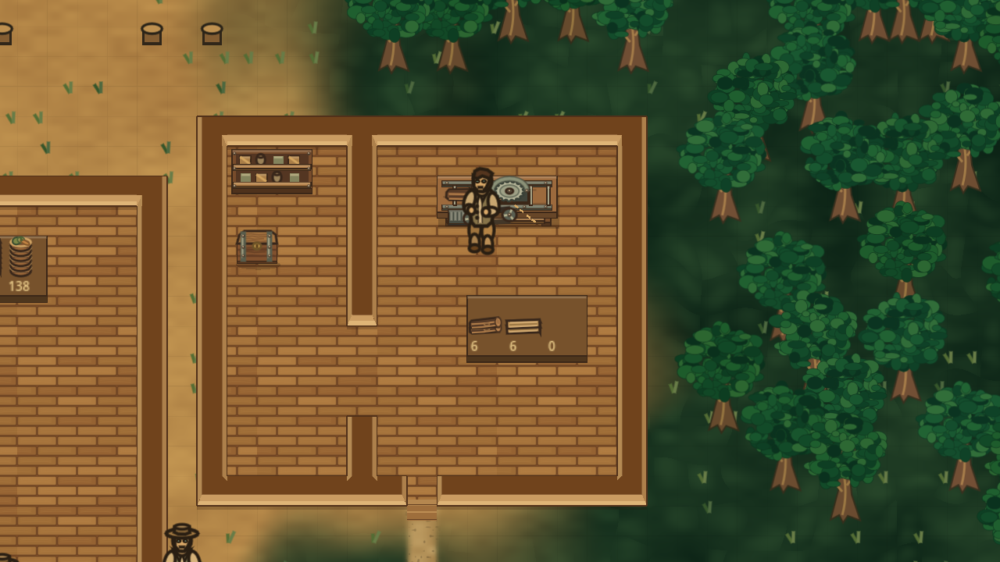](screenshots/workshop-production.png) **The sawmill turning logs into planks** |
| [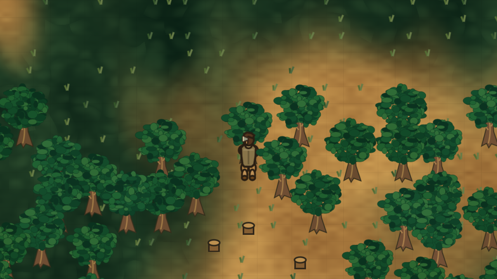](screenshots/forest-harvest.png) **Harvesting timber in the woodland** |  **Buying stock at the timber stall** |
| [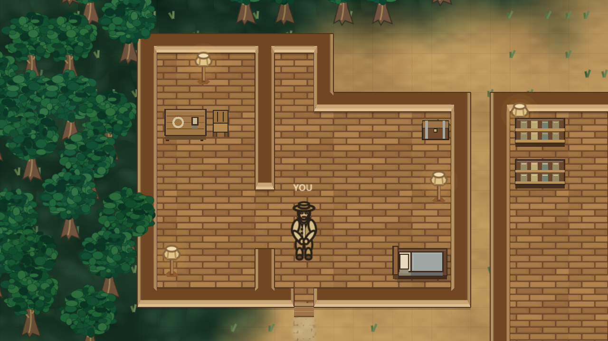](screenshots/room-design.png) **Inside the common lodge** |  **Wall construction from the central stockpile** |
| [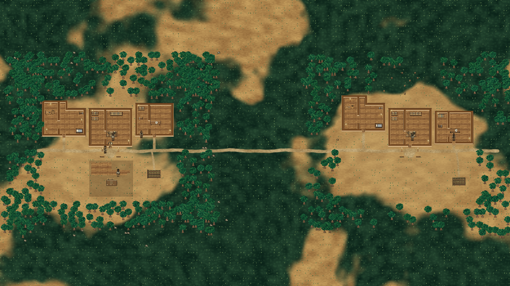](screenshots/world-landscape.png) **Alder Hollow, Reedbank, and the road between them** | [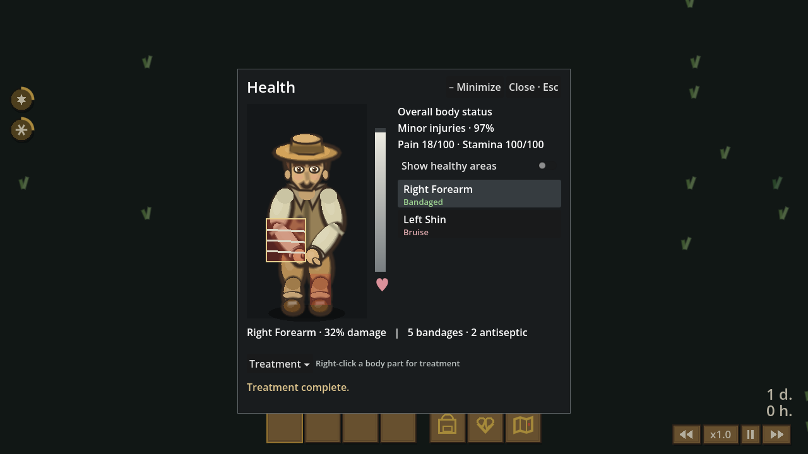](screenshots/player-health.png) **Examining injuries and bandages** |

[Character turnaround](screenshots/character-design.png) ·
[Walk, sprint and handling animation](screenshots/character-motion.gif) ·
[Close-ups of props and furniture](screenshots/prop-detail.png)

The forest, workshop, and trading screenshots can be regenerated by running
`godot --path . --script res://tests/screenshots_capture.gd` with a graphical
display. The [current game guide](CURRENT_GAME.md#visual-examples-and-how-to-reproduce-them)
lists the other capture scripts.

## Rye, households, trades, weapons and indicators

| | |
|---|---|
| [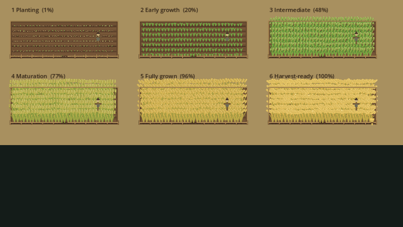](screenshots/rye-growth.png) **Rye from planting to harvest-ready** | [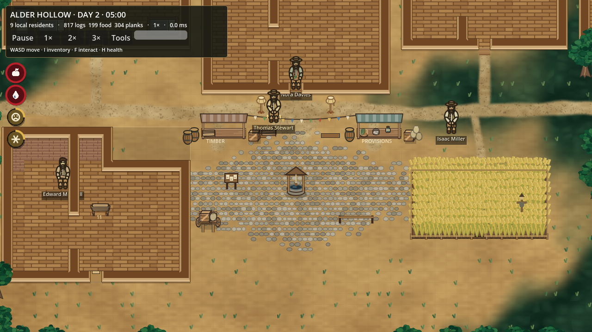](screenshots/market-plaza.png) **The market plaza with a ripe rye field beside it** |
|  **The sheriff's office and weapon rack** |  **Beds in all four orientations, heads against walls** |
| [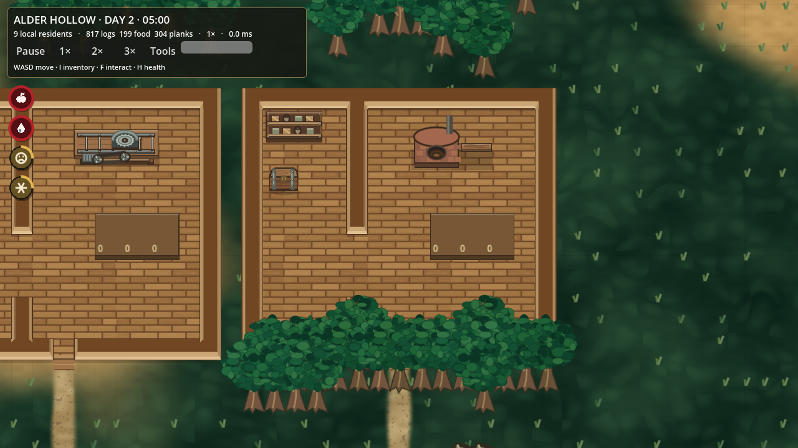](screenshots/bakery.png) **The bakery** |  **Top-left condition indicators and name tags** |
| [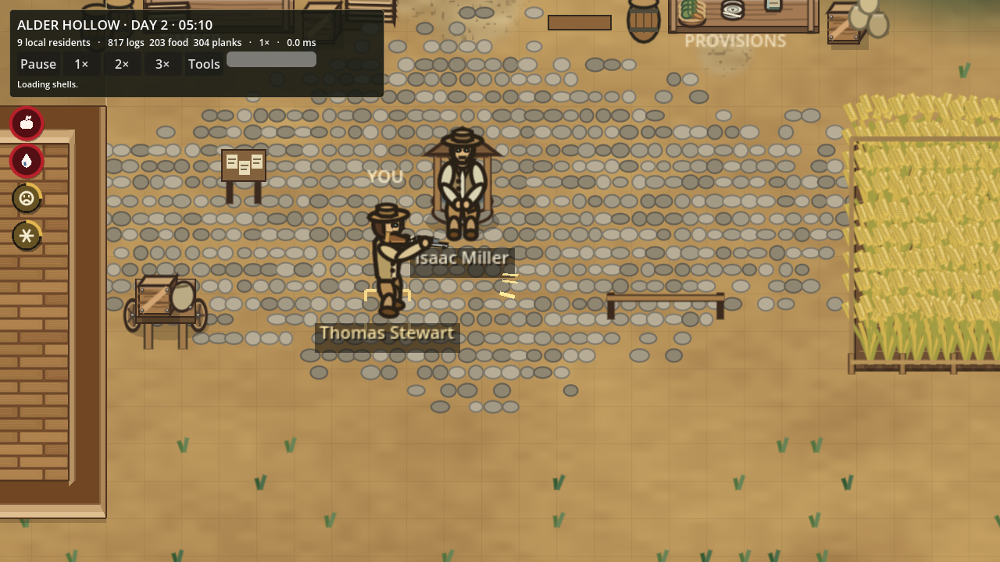](screenshots/shotgun-fire.png) **Shotgun aimed, pellets in flight** | [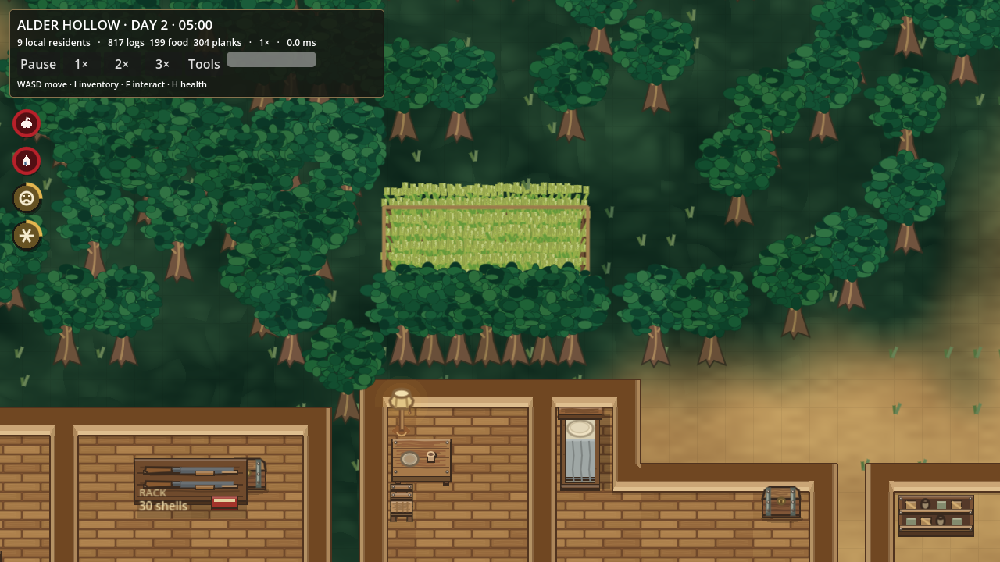](screenshots/household-garden.png) **A household garden behind the lodge** |
